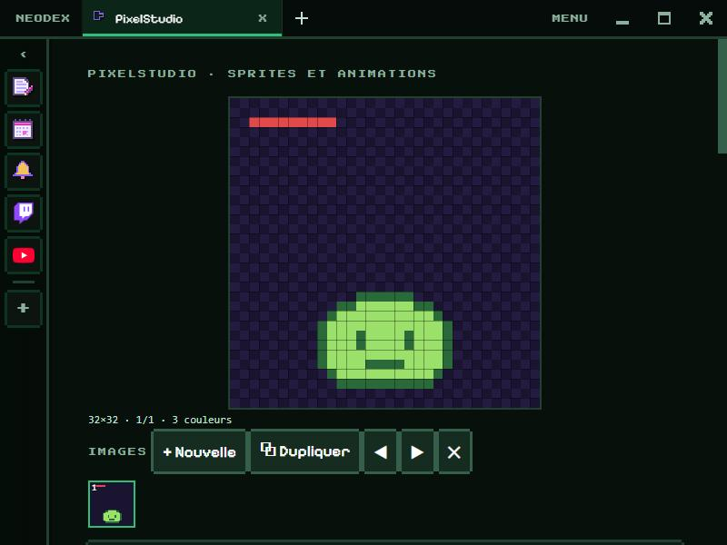

# PixelStudio

Draw and animate your pixel art sprites, then export them for your games.

*Version française : [README.md](README.md)*

## Drawing

- Sizes from 8 × 8 to 64 × 64; the checkerboard shows transparency.
- Tools (with their key): **pencil** (B), **eraser** (E), **paint bucket** (G), **eyedropper** (I, or right click), **line** (L), **rectangle** (R) and **filled rectangle** (Shift+R), **move** the image (M).
- **Mirror**: everything you draw is copied mirrored. **Flip** and **rotate** the image in one click.
- **Undo** (Ctrl+Z) and **redo** (Ctrl+Y), 60 steps.
- 32-colour palette: **Edit** changes the chosen colour, everywhere it is used.

## Animating

**+ New** frame, **⧉ Duplicate** (the handiest way to animate), ◀ ▶ to reorder, ✕ to delete. **Onion skin** shows the previous frame faded. The preview loops, from 1 to 24 frames per second. Keys **,** and **.**: previous or next frame.

## Export

With a scale from × 1 to × 16: **PNG** of the current frame, **PNG sheet** of every frame side by side, or **animated GIF** (transparency kept, 256 colours at most). Each time it opens, a small GIF is made then read back by the browser to check the encoder.

## Data

The drawing, its frames, the palette and the speed are kept in the plugin folder. Permission: `storage` only.
