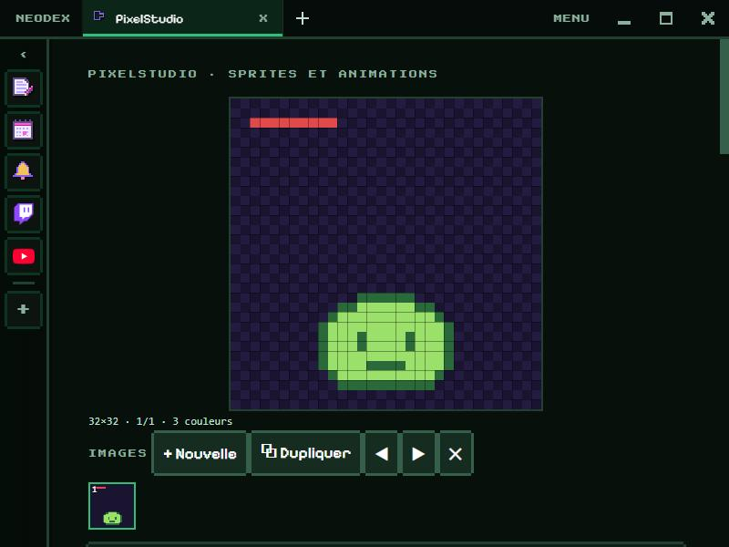

# PixelStudio

Dessine et anime tes sprites pixel art, puis exporte-les pour tes jeux.

*English version: [README.en.md](README.en.md)*

## Dessiner

- Tailles de 8 × 8 à 64 × 64 ; le damier montre la transparence.
- Outils (avec leur touche) : **crayon** (B), **gomme** (E), **pot de peinture** (G), **pipette** (I, ou clic droit), **ligne** (L), **rectangle** (R) et **rectangle plein** (Maj+R), **déplacer** l'image (M).
- **Symétrie** : tout ce que tu dessines est recopié en miroir. **Retourner** et **tourner** l'image d'un clic.
- **Annuler** (Ctrl+Z) et **refaire** (Ctrl+Y), 60 étapes.
- Palette de 32 couleurs : **Modifier** change la couleur choisie, et partout où elle est utilisée.

## Animer

**+ Nouvelle** image, **⧉ Dupliquer** (le plus pratique pour animer), ◀ ▶ pour changer l'ordre, ✕ pour supprimer. La **pelure d'oignon** montre l'image précédente en transparence. L'aperçu tourne en boucle, de 1 à 24 images par seconde. Touches **,** et **.** : image précédente ou suivante.

## Exporter

Avec un agrandissement de × 1 à × 16 : **PNG** de l'image en cours, **planche PNG** de toutes les images côte à côte, ou **GIF animé** (transparence gardée, 256 couleurs au plus). À chaque ouverture, un petit GIF est fabriqué puis relu par le navigateur pour vérifier l'encodeur.

## Données

Le dessin, ses images, la palette et la vitesse sont gardés dans le dossier du plugin. Autorisation : `storage` seulement.
